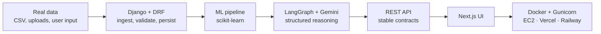

<div align="center">

# Krishal Karna


**I build the backend and the model. Then I build the UI so people can actually use it.**

[Portfolio](https://krishalkarna.com.np) ·
[LinkedIn](https://www.linkedin.com/in/krishalkarna) ·
[Blog](https://completesql.hashnode.dev/series/learn-mysql) ·
[LeetCode](https://leetcode.com/u/kreeshal17/) ·
[karnakreeshal@gmail.com](mailto:karnakreeshal@gmail.com)

</div>

---

## About

Final-year CS student at Jain University, Bangalore — CGPA 9.5/10, graduating June 2027. Backend and applied ML is where I live. Frontend is a tool I picked up because a model sitting in a notebook helps nobody.

Most of what I build follows the same shape:



- **Backend first** — Django + DRF, JWT auth, schema design, API contracts that don't change every week
- **Applied ML, not toy ML** — anomaly detection, imputation, similarity search, inside real request/response cycles
- **LLM systems** — LangGraph agents and Gemini pipelines that return structured output, not vibes
- **Deployment is part of the job** — Docker, Gunicorn, AWS EC2, Vercel, Railway

---

## Featured Work

| Project | What it does | Stack |
| :-- | :-- | :-- |
| **[DataLens AI](https://github.com/kreeshal17/Datalens-AI)** | Upload a CSV, get back a real data-quality verdict — profiled, scored, diagnosed and explained | DRF · Next.js · Postgres · scikit-learn · LangGraph · Docker · EC2 |
| **[Luma AI Studio](https://github.com/kreeshal17/LUMA-AI-STUDIO)** | Coding agent that generates *and incrementally edits* live React components from prompts | Next.js · TS · FastAPI · Postgres · Sandpack |
| **[BookMandu](https://bookmandu.vercel.app)** | Multi-vendor book marketplace with delivery-gated reviews, so only real buyers can review | Next.js · Prisma · Postgres · Tailwind |

<details>
<summary><b>DataLens AI — what's actually under the hood</b></summary>

<br/>

The interesting part isn't the upload form, it's what runs after it.

**1 · Profiling.** Row- and column-level statistics — type inference, null density, cardinality, distribution shape — rolled into a single quality score you can track across uploads.

**2 · The scikit-learn pass.** Three models, each answering a different question:

| Model | Question it answers |
| :-- | :-- |
| Isolation Forest | Which rows don't belong? |
| KNN imputation | What should the missing values have been? |
| TF-IDF + cosine similarity | Which rows are near-duplicates of each other? |

**3 · Root cause.** A LangGraph + Gemini layer takes those raw findings and turns them into plain-language explanations plus *structured* fix recommendations — enforced schema, so the frontend can render them instead of parsing prose.

**4 · Shipping it.** Backend containerized with Docker + Gunicorn on EC2, managed Postgres, frontend on Vercel. The ML runs inside the request cycle, so latency budgets were a design constraint, not an afterthought.

</details>

<details>
<summary><b>Luma AI Studio — the incremental-edit problem</b></summary>

<br/>

Generating a component from scratch is the easy half. The hard half is the second prompt: *"now make the sidebar collapsible"* — without regenerating and breaking everything else.

Solved with a component-driven architecture where each generation is a diff against persisted session state rather than a fresh render. Live preview through Sandpack, session history in Postgres, GitHub OAuth so the result can be pushed straight to a repo. Vercel + Railway.

</details>

---

## Stack

| | |
| :-- | :-- |
| **Languages** | Python · TypeScript · JavaScript · SQL · Java |
| **Backend** | Django · Django REST Framework · FastAPI · JWT auth · REST API design |
| **ML & LLM** | scikit-learn · pandas · NumPy · LangChain · LangGraph · Google Gemini |
| **Databases** | PostgreSQL · MySQL · Prisma |
| **Frontend** | Next.js · React · Tailwind CSS |
| **Infra** | Docker · AWS EC2 · Gunicorn · Vercel · Railway · Git · Power BI |

---

## Experience

**Full Stack Developer Intern** — Mahalaxmi Tech Group Pvt. Ltd. (Remote) · *Jan 2026 – Mar 2026*
Built Next.js pages and reusable UI components wired to Django REST APIs I also developed. PR-based GitHub flow: code review, debugging, API integration, cross-stack feature work.

**Technical Team Lead** — Enigma Club, Jain University · *Oct 2025 – Apr 2026*
Led a technical team across events and initiatives, ran coding workshops, mentored juniors on Git workflows and technical planning.

---

## How I Got Here

```text
Java + DSA + Spring Boot  →  scikit-learn & applied ML  →  FastAPI model serving  →  Django + DRF
        (year 1)                    (year 2)                     (year 3)              (now)
```

Started backend-heavy in Java, got pulled into ML in second year, learned to serve models as APIs with FastAPI, then moved to Django + DRF for the systems I actually want to build — production apps where the model is one component of a real product, not the whole demo.

**Going deeper right now:** multi-agent LangGraph workflows · RAG and retrieval pipelines · model serving at scale · Django internals and query optimization

---

## LeetCode

<div align="center">

<picture>
  <source media="(prefers-color-scheme: dark)" srcset="https://raw.githubusercontent.com/kreeshal17/kreeshal17/main/assets/leetcode-120d-dark.svg">
  
</picture>

<br/>

<a href="https://leetcode.com/u/kreeshal17/">
  
</a>

<br/>

<sub>Last 120 days, pulled from LeetCode's GraphQL API by <a href="scripts/leetcode_heatmap.py">a script</a> and redrawn daily by <a href=".github/workflows/leetcode-heatmap.yml">an Action</a>.</sub>

</div>

---

## GitHub

<div align="center">


</div>

---

## Beyond the Code

- 🎓 **EdCIL COMPEX Scholar** — merit-based Government of India scholarship covering full undergraduate tuition
- 🧩 **250+ DSA problems** on [LeetCode](https://leetcode.com/u/kreeshal17/) — arrays, graphs, DP, SQL
- ✍️ **[Learn MySQL series](https://completesql.hashnode.dev/series/learn-mysql)** on Hashnode — SQL from fundamentals to query design
- 📜 HackerRank Advanced SQL · Google Cloud Generative AI · IBM Applied AI · IBM SkillsBuild Data Fundamentals

---

<div align="center">

### Open to backend, ML and AI engineering roles — 2027 batch

Talk to me about Django architecture, getting models out of notebooks, or LangGraph agents that behave.

**[karnakreeshal@gmail.com](mailto:karnakreeshal@gmail.com)** · **[krishalkarna.com.np](https://krishalkarna.com.np)**

</div>
